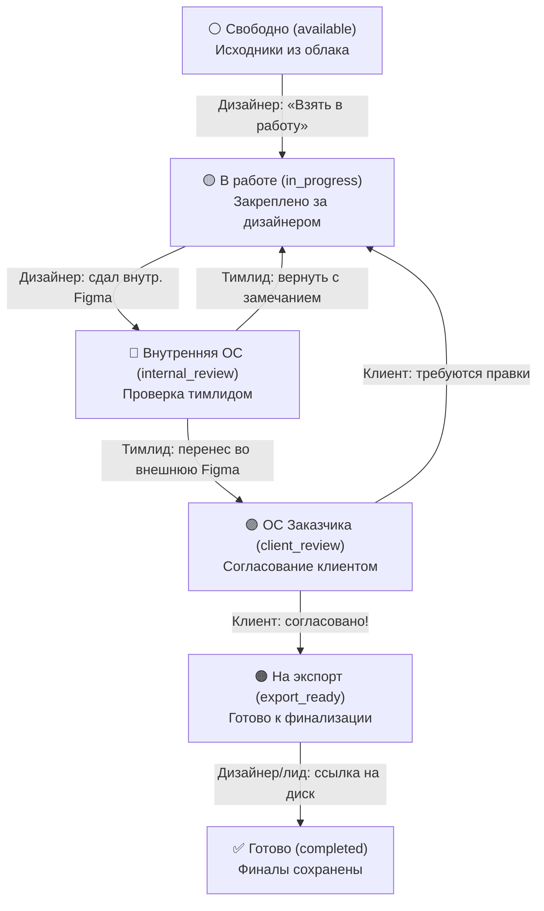
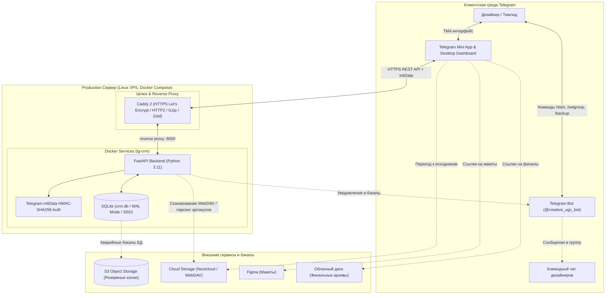

# 🏗 Архитектура и описание проекта Creative UGC CRM

## 1. 📌 Обзор проекта

**Creative UGC CRM** — система управления производством и обработкой визуального контента дизайнерами команды с глубокой интеграцией в Telegram (Bot + Mini App).

Система решает задачи распределенной команды дизайнеров и тимлидов:
* **Исключение коллизий:** мгновенная блокировка задачи за дизайнером в 1 клик.
* **Сквозной пайплайн:** контроль этапов артикула от исходных фото до выгрузки на облачный диск.
* **Прямые ссылки на исходники:** автоматическое формирование прямых ссылок в облачном хранилище (Nextcloud / WebDAV) без необходимости авторизации в корпоративных аккаунтах.
* **Нативный клиент Telegram:** адаптивный веб-интерфейс Telegram Mini App (TMA) для мобильных и десктопных клиентов + Telegram-бот для мгновенных уведомлений в чат команды.
* **Хостинг:** рабочий контур развернут на независимом Linux VDS в Docker-контейнерах за веб-сервером Caddy (быстрый отклик без необходимости использования VPN).

---

## 2. 🔄 Пайплайн жизненного цикла задачи

Каждая задача проходит 6 этапов:



### Статусы задач:
1. **⚪ Свободно (`available`):** задача в общем пуле, любой авторизованный дизайнер может забрать её.
2. **🟡 В работе (`in_progress`):** закреплена за конкретным исполнителем.
3. **🔵 Внутренняя ОС (`internal_review`):** макет сдан дизайнером и ожидает ревью арт-директора/тимлида.
4. **🟣 ОС Заказчика (`client_review`):** макет прошел внутреннее ревью и передан на утверждение клиенту.
5. **🟠 На экспорт (`export_ready`):** утвержден заказчиком, требуется выгрузка и загрузка финалов.
6. **✅ Готово (`completed`):** финальные файлы загружены на диск, артикул закрыт.

---

## 3. 🏛 Системная архитектура



---

## 4. 🧩 Компоненты системы

### 4.1. Клиентская часть (Frontend)
* **Telegram Mini App (`static/index.html`, `static/app.js`, `static/style.css`):**
  - Оптимизированный нативный интерфейс без внешних фреймворков и CDN.
  - Локальные самохостящиеся шрифты **Onest** и **JetBrains Mono** (`static/fonts.css`, `static/fonts/`).
  - Локальный скрипт `static/telegram-web-app.js` для гарантированной автономности.
  - Реактивная смена статусов задач in-place, быстрый поиск и фильтрация по пулам и статусам.
  - Поддержка возврата задач в свободные, назначения дизайнеров и привязки трекинга Битрикс24.
* **Desktop Dashboard (`static/desktop.html`, `static/desktop.js`, `static/desktop.css`):**
  - Полноэкранный адаптивный дашборд для ПК с расширенной аналитикой и управлением пулами.

### 4.2. Веб-сервер и SSL (Caddy 2)
* **Роль:** Обратный прокси (Reverse Proxy) и автоматическое управление TLS/HTTPS через Let's Encrypt.
* **Сжатие:** Включены Gzip и Zstandard для ускорения отдачи статики и JSON.
* **Конфигурация:** Домен и email администратора конфигурируются через переменные окружения `APP_DOMAIN` и `ACME_EMAIL`.

### 4.3. Backend & API (FastAPI)
* **Стек:** Python 3.11, FastAPI, Uvicorn, Pydantic v2, Aiohttp, Boto3, OpenPyXL.
* **Режимы работы:**
  - **Production:** Telegram Long Polling + строгая валидация подписи `initData` (HMAC-SHA256).
  - **Local Dev (`DEV_MODE=True`):** локальная эмуляция ролей (Лид / Дизайнер) для отладки в браузере.
* **Экспорт:** Выгрузка сводных отчетов в Excel (`.xlsx`) и прямая синхронизация с Google Таблицами через Google Apps Script Webhook.

### 4.4. База данных и резервное копирование
* **SQLite3 (WAL-режим):** База хранится локально на SSD сервера (`/opt/tg-crm/crm.db`), смонтирована в Docker-контейнер через volume bind-mount.
* **Бэкапы:**
  - Локальный ротационный бэкап при каждом автодеплое (`crm.db.bak_YYYYMMDD_HHMMSS`).
  - Отправка бэкапа в Telegram по команде `/backup` или через админ-эндпоинт.
  - Резервная выгрузка в S3 Object Storage при внесении изменений.

---

## 5. 🔐 Безопасность и управление секретами

1. **Криптографическая верификация:** Каждый запрос из Mini App проверяется по подписи Telegram бота (`initData`). Запросы без валидной подписи в продакшене отклоняются (401 / 403).
2. **Изоляция секретов:**
   - Токены бота, ключи S3 и сервисные пароли хранятся исключительно в неверсионируемых файлах `.env` и `.env.prod`.
   - Файлы конфигурации окружения надежно заблокированы в `.gitignore`.
3. **Безопасный деплой:**
   - Автодеплой `deploy_prod.py` приоритетно использует SSH-ключи (`~/.ssh/id_rsa`).
   - Пароль для резервного подключения читается из переменной окружения `DEPLOY_SERVER_PASS` в `.env.prod` либо запрашивается интерактивно, исключая попадание в репозиторий.

---

## 6. 🚀 Эксплуатация и команды

### 6.1. Автоматический деплой на сервер
Выполняется одной командой из корня проекта:
```powershell
deploy_prod.bat
```
*(Скрипт проверяет подключение, создает бэкап базы данных на сервере, синхронизирует измененные файлы через SFTP и бесшовно перезапускает Docker-контейнер).*

### 6.2. Удаленное выполнение команд на сервере
Скрипт `run_remote.ps1` выполняет команды на боевом сервере через SSH-ключ:
```powershell
# Статус контейнеров
.\run_remote.ps1 "docker compose ps"

# Просмотр логов бэкенда
.\run_remote.ps1 "docker logs --tail 50 tg-crm-app"

# Просмотр логов веб-сервера Caddy
.\run_remote.ps1 "docker logs --tail 50 tg-crm-caddy"
```

### 6.3. Локальный запуск для разработки
```powershell
# Запуск полного сервера с локальным интерфейсом (порт 8000)
.\start.bat

# Запуск изолированного превью с тестовыми данными (порт 8001)
.\preview.bat
```

### 6.4. Прогон тестов
```powershell
# Тесты фронтенда (Node.js)
node --test tests/frontend.test.cjs

# Тесты бэкенда и полного жизненного цикла (Python)
.\venv\Scripts\python.exe -m unittest discover -s tests -p "test_*.py"
```
