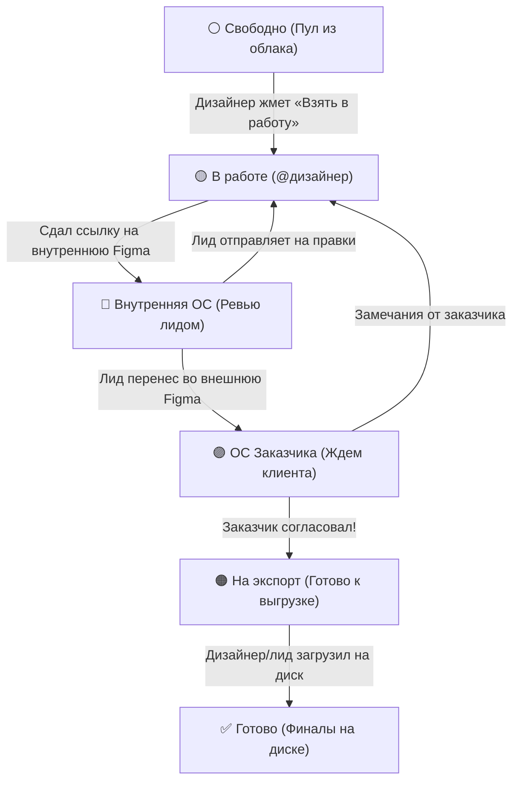

# 🚀 Creative UGC CRM

Система управления задачами для создания и генерации визуалов дизайнерами команды с интеграцией в **Telegram (Bot + Mini App)**.

> 📖 **Полная документация и схема:** подробное описание компонентов, архитектуры хостинга и безопасности читайте в [ARCHITECTURE.md](file:///d:/dev/experiments/tg%20crm/ARCHITECTURE.md). Спецификация UI и дизайн-токены описаны в [DESIGN.md](file:///d:/dev/experiments/tg%20crm/DESIGN.md).

---

## 📌 Архитектура и пайплайн



---

## 🛠 Возможности

1. **Telegram Mini App (TMA) & Desktop Dashboard:**
   * Открывается прямо в Telegram в один клик.
   * Адаптивный мобильный и десктопный интерфейс в темной теме Dark Slate & Lime.
   * Автономные шрифты (Onest, JetBrains Mono) и локальный скрипт Telegram WebApp.
   * Автоматическая авторизация через Telegram (`initData`) — без паролей.
   * Разделение ролей: **👑 Тимлид / Админ** и **🎨 Дизайнер**.
   * Фильтры: *Свободные*, *Мои в работе*, *На ревью*, *На экспорт*, *Готово*.
   * Поиск по артикулу (например, `129829`), имени исполнителя или пулу.

2. **Защита от коллизий:**
   * Как только дизайнер нажимает **«Взять в работу»**, артикул моментально блокируется за ним.
   * В командный чат уходит уведомление: `🎨 @username взял 129829OUT-99`.
   * Поддерживается возврат задачи в свободные исполнителем или администратором.

3. **Быстрое добавление пула (для тимлида):**
   * Вставляется ссылка на родительскую папку в облачном хранилище (Nextcloud / WebDAV).
   * Вставляется список артикулов из буфера обмена (по одному в строке или через запятую).
   * Бот генерирует задачи с прямыми ссылками и уведомляет чат.

4. **Интеграция с рабочим чатом Telegram:**
   * Бот оповещает команду о новых пулах, взятых задачах, сданных макетах и финалах в облаке.

---

## ⚡ Быстрый старт на компьютере

### 1. Запуск сервера разработки
Дважды кликните по файлу **`start.bat`** или выполните в терминале:
```powershell
.\venv\Scripts\Activate.ps1
python main.py
```
Сервер запустится на `http://localhost:8000`.

### 2. Изолированный просмотр UI (Preview)
Для проверки интерфейса без запуска бота и с временными данными:
```powershell
preview.bat
```
Откроется на `http://127.0.0.1:8001`.

---

## 📲 Подключение Telegram-бота к рабочей группе

1. **Добавьте бота в чат с дизайнерами:**
   * Добавьте вашего созданного в `@BotFather` бота в рабочий чат.
   * Сделайте его администратором группы (или дайте право писать сообщения).
2. **Привяжите чат к боту:**
   * Внутри вашей группы дизайнеров отправьте команду:
     ```text
     /setgroup
     ```
   * Бот ответит: `✅ Группа подключена!` и запомнит ID вашего чата для всех уведомлений.

---

## 🌐 Продакшен-хостинг и деплой

Сервер разворачивается на любом Linux VPS (Ubuntu 22.04 / 24.04):
* **Веб-сервер:** Caddy 2 с автоматическим HTTPS от Let's Encrypt.
* **Бэкенд:** Docker Compose (`FastAPI` + `Caddy`).

### 1-Click Деплой на боевой сервер:
```powershell
deploy_prod.bat
```
Скрипт создает бэкап базы данных на сервере, синхронизирует локальные файлы через SFTP и бесшовно пересобирает Docker-контейнер.

---

## 🔒 Безопасность и приватность

* В продакшене (`DEV_MODE=False`) сервер отклоняет любые запросы без валидной криптографической подписи Telegram (`initData`).
* Посторонние пользователи из глобального поиска Telegram видят заглушку об отказе в доступе.
* Все токены и ключи изолированы в локальных файлах `.env` / `.env.prod` и не попадают в репозиторий.
